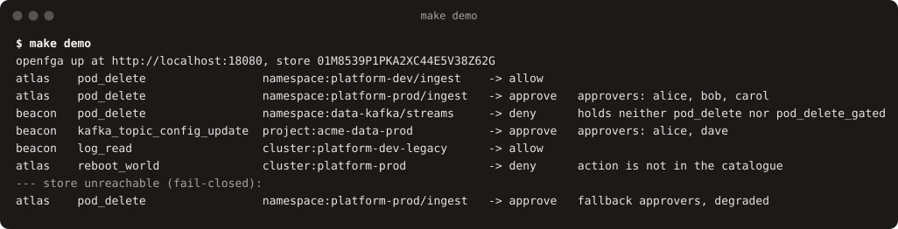

# bab

bab (باب, "door") decides whether an AI agent may take an action on a resource: allow, ask a person, or deny.

[](https://github.com/tenishai/bab/actions/workflows/ci.yml)
[](https://github.com/tenishai/bab/releases)
[](LICENSE)
[](#status)



## Two ways to run it

- **Try it on a laptop.** The [Quickstart](#quickstart) starts OpenFGA in Docker and
  prints real verdicts, with no cluster. bab also works alone, as a library or an HTTP
  service in front of your own agents.
- **Run it with the platform.** In the tenish suite the gateway asks bab before each tool
  call. Install [gojira](https://github.com/tenishai/gojira) on a GKE cluster and bring the
  suite up with [stack](https://github.com/tenishai/stack). Stack's example file does not list
  bab yet; it deploys through gojira like any other app, from the `gojira.yaml` and `k8s/`
  in this repo.

## Overview

An agent that can delete a pod or change a topic needs an answer to one question before
it does: may this agent do this, here? bab answers it with one of three verdicts.

- **allow**: go ahead.
- **approve**: a person on the team that owns the resource has to say yes; bab names them.
- **deny**: the default.

The rules live in [OpenFGA](https://openfga.dev). You describe your resources and actions
in a small YAML catalogue, bab generates the OpenFGA model from it, and nobody edits the
model by hand. If the store cannot be reached, the answer is never allow.

## Quickstart

You need Python 3.11 or newer, Docker and `make`.

```
git clone https://github.com/tenishai/bab && cd bab
python3 -m venv venv && venv/bin/pip install -e .
make demo PY=venv/bin/python
```

`make demo` fetches the OpenFGA CLI, starts OpenFGA in Docker, loads the example
catalogue and asks six questions, then one more with the store unreachable:

```
atlas  pod_delete  namespace:platform-dev/ingest   -> {"verdict": "allow", ...}
atlas  pod_delete  namespace:platform-prod/ingest  -> {"verdict": "approve", "approvers": ["user:alice", "user:bob", "user:carol"], ...}
beacon pod_delete  namespace:data-kafka/streams    -> {"verdict": "deny", "reason": "agent:beacon holds neither pod_delete nor pod_delete_gated on ...
--- store unreachable (fail-closed):
{"verdict": "approve", "reason": "store unreachable; fallback approvers", "degraded": true}
```

`make demo-down` stops it. To ask from your own code:

```python
from bab import Door, catalogue
from bab.store import OpenFgaStore

door = Door(OpenFgaStore(url, store_id), catalogue.load("catalogues/example.yaml"),
            fallback_approvers=("user:alice@example.com",))
d = door.decide("atlas", "pod_delete", "namespace:platform-prod/ingest")
# d.verdict in {ALLOW, APPROVE, DENY}; d.approvers; d.reason; d.degraded
```

## Where it fits

bab is the permissions member of the tenish family of open-source platform and agent
projects, each usable on its own.

| Part | What it does |
|---|---|
| [liminal](https://github.com/tenishai/liminal) | the gateway agents reach tools through; it asks bab |
| [kobo](https://github.com/tenishai/kobo) | where people build agents and grant them access |
| [gojira](https://github.com/tenishai/gojira) | deploys |
| [sero](https://github.com/tenishai/sero) | keeps secrets |
| [noto](https://github.com/tenishai/noto) | observes |

## How it works

- **A catalogue generates the model.** `catalogues/*.yaml` lists the resource levels and
  the actions; `bab model` turns it into OpenFGA's language. CI fails if the generated
  model drifts from the catalogue.
- **Three sources write to the store, and nothing else does.** An identity sync (people
  to teams), a topology sync (the resource tree and who owns it), and grants. A grant is
  checked against the team's ceiling when it is written.
- **One check at the moment of the action.** `Door.decide` runs where the agent
  dispatches a tool. No console sits in that path.
- **Grants expire.** A grant carries a time window and every check passes the current
  time, so it stops answering yes on the dot. Read grants stand; grants that change or
  destroy things expire by default.
- **A service for fleets.** `bab serve` puts the same decisions behind HTTP, keeps a
  ledger of requests and grants, and hands out one-hour credentials for a granted
  permission.

| Path | What |
|---|---|
| `catalogues/*.yaml` | resource levels and actions; one profile per deployment (the example ships) |
| `bab/model.py` | catalogue to OpenFGA model |
| `bab/door.py` | the decision, fail-closed |
| `bab/ceiling.py` | write-time check: may this team hold this grant? |
| `bab/sync/` | identity and topology syncs |
| `bab/service/` | the HTTP service (`bab serve`) |
| `model/example.fga.yaml` | the example's fixture and assertions |

## Status

Alpha. The decision, the generated model, the syncs, expiring grants and the HTTP service
are built and run in our own deployment. Interfaces can still change between minor
versions; [CHANGELOG.md](CHANGELOG.md) says what changed. Running pinned assertions
against a policy change before it lands is designed, not built.

## Documentation

- [docs/design.md](docs/design.md): the data model and the decision
- [docs/design-leases.md](docs/design-leases.md): expiring grants, requests and short-lived credentials
- [ARCHITECTURE.md](ARCHITECTURE.md): a map of the code, for people and coding agents
- [RELEASING.md](RELEASING.md): how a release is cut and what it contains
- [SECURITY.md](SECURITY.md): how to report a vulnerability

## Contributing

Issues and pull requests are welcome. [CONTRIBUTING.md](CONTRIBUTING.md) has the setup,
the checks CI runs and the sign-off every commit needs; the
[Code of Conduct](CODE_OF_CONDUCT.md) applies to everyone taking part.

## How this was built

tenishai is a small team of engineers who build with AI coding agents. Most of
this code was written in pairing sessions with Claude models in Claude Code: a
person set the design, directed the work and reviewed what landed, and the
agent wrote much of the code and docs. Many commits name the agent in a
`Co-Authored-By:` trailer, either a Claude model or Poe (earlier Raven), the
name of the agent one of us pairs with. A commit without a trailer may still
have had AI help.

In this repo, "Ember (SRE AI)" in docs and pull requests is the agent Shaz pairs
with. Its commits name the Claude model in the trailer, not Ember.

## License

MIT (see [LICENSE](LICENSE)).

Copyright (C) 2026 tenish and the bab contributors
